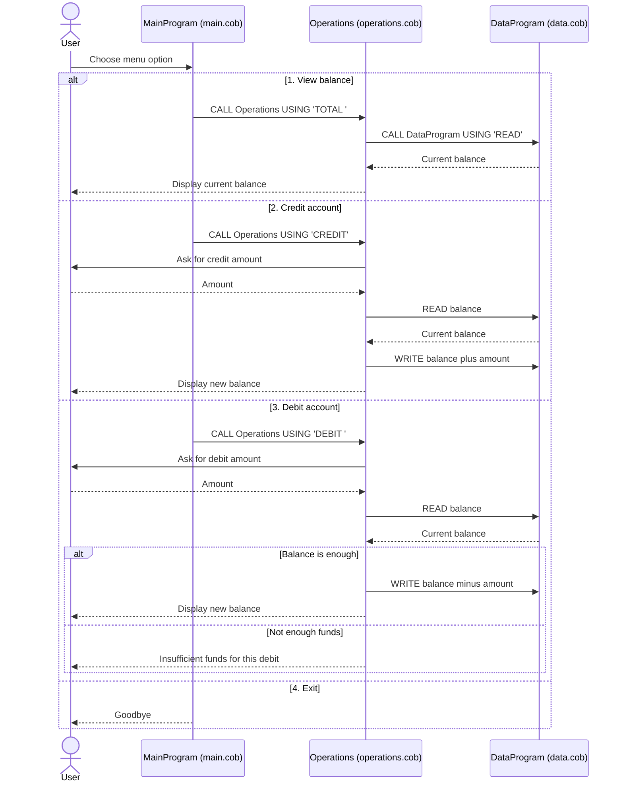

# Student Account Management System (COBOL)

This legacy COBOL application manages the balance of a student account. Staff can view the balance, credit the account and debit the account from a simple text menu.

## Files

### src/cobol/main.cob (MainProgram)

The entry point of the application.

- Shows the menu: view balance, credit account, debit account, exit.
- Reads the user choice and calls the `Operations` program with the matching operation code (`TOTAL `, `CREDIT` or `DEBIT `).
- Repeats until the user picks option 4, and rejects any choice outside 1 to 4.

### src/cobol/operations.cob (Operations)

Holds the business logic for each operation.

- `TOTAL `: reads the balance from `DataProgram` and displays it.
- `CREDIT`: asks for an amount, reads the balance, adds the amount, writes the new balance back and displays it.
- `DEBIT `: asks for an amount, reads the balance, and only if the balance is greater than or equal to the amount subtracts it, writes it back and displays it. Otherwise it displays "Insufficient funds for this debit."

### src/cobol/data.cob (DataProgram)

Acts as the data store for the balance.

- Keeps the balance in working storage, starting at 1000.00.
- `READ` copies the stored balance to the caller.
- `WRITE` saves the balance passed by the caller.

## Business rules for student accounts

- Every account starts with a balance of 1000.00.
- Amounts and balances use the format `PIC 9(6)V99`: up to 999999.99, two decimals, no negative values.
- A debit is refused when it is larger than the current balance, so the balance can never go below zero.
- The balance only lives in memory while the program runs. It is not saved between runs.

## Data flow

